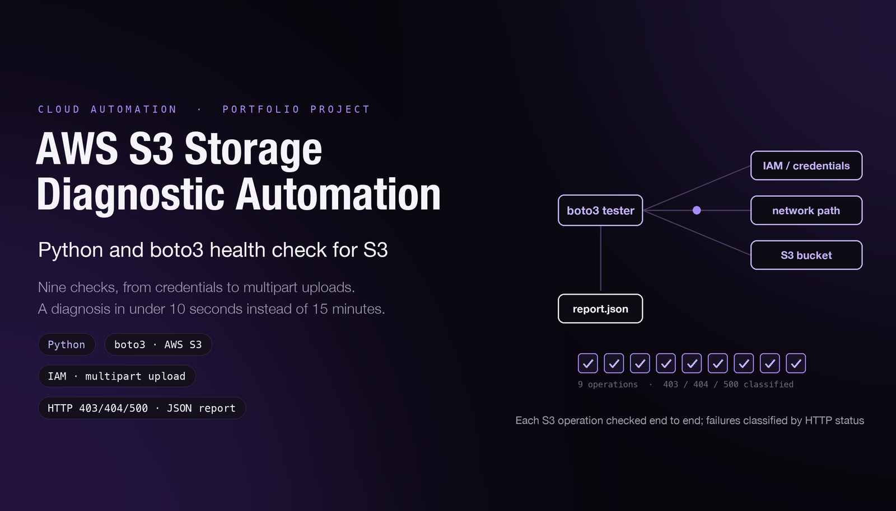

# AWS S3 Connectivity Tester



A Python/boto3 diagnostic tool for checking AWS credentials and S3 API operations. It reports which checks passed or failed and writes a timestamped JSON report.

## What the code checks

- AWS credential validation through STS.
- Bucket listing and creation of a uniquely named test bucket.
- Object upload, read, metadata retrieval, and deletion.
- Multipart upload and a request to enable bucket versioning.
- Cleanup of the test resources, with partial failures reported.

These checks exercise SDK access, permissions, and service operations. They do not isolate every possible network-path fault.

## Requirements

- Python 3.10 or newer.
- AWS credentials available through the standard SDK credential chain, such as an existing AWS CLI profile.
- Permission to perform the tested STS and S3 operations in a test account.

## Setup

```bash
git clone https://github.com/Jeevanandh32/AWS-S3-Connectivity-Tester.git
cd AWS-S3-Connectivity-Tester
python3 -m venv .venv
source .venv/bin/activate
python -m pip install -r requirements.txt
```

On Windows, activate the environment with `.venv\Scripts\activate`.

## Run

Use the default AWS profile and region:

```bash
python s3_connectivity_tester.py
```

Or select an existing profile and pass a region:

```bash
export AWS_PROFILE=your-test-profile
python s3_connectivity_tester.py us-west-2
```

The program creates a test bucket, writes and deletes test objects, changes that bucket's versioning setting, and attempts cleanup. It prints individual results and writes `s3_test_report_YYYYMMDD_HHMMSS.json`. Check any cleanup warning before leaving the account.

## Repository files

| File | Purpose |
|---|---|
| `s3_connectivity_tester.py` | Main diagnostic workflow and JSON reporting |
| `s3_operations.py` | Additional bucket and object operation examples |
| `s3_error_handling.py` | Examples of handling SDK exceptions and S3 error responses |
| `requirements.txt` | Python SDK dependency |

## Measurement and implementation limits

- No committed timing dataset establishes a speedup over manual diagnosis.
- Versioning coverage checks configuration requests; it does not test restoring earlier object versions.
- Cleanup is best-effort: the implementation does not enumerate every object version, delete marker, or unfinished multipart upload. Inspect and remove any leftover test resources if a run fails or is interrupted.
- A successful run applies to the credentials, region, and operations tested; it is not a general statement about all S3 permissions or network paths.
